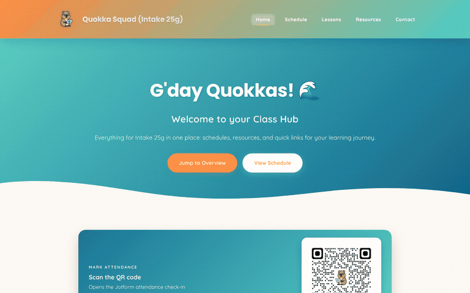
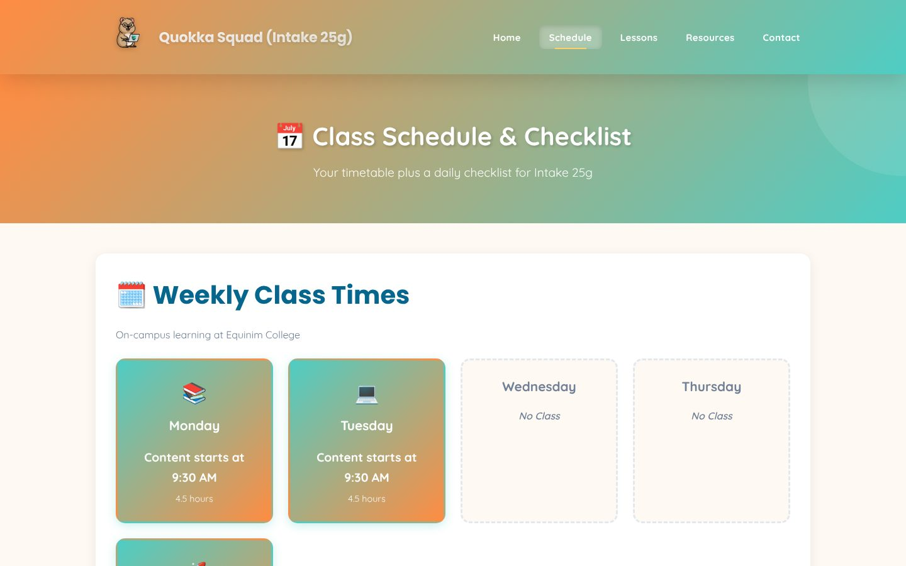
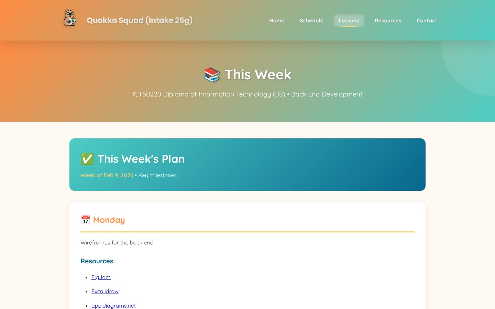
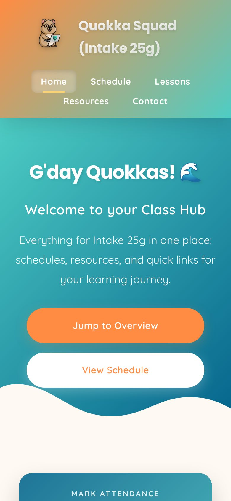

# EQC Hub — Quokka Squad (Intake 25G)

> Class hub website for Equinim College's Intake 25G: weekly plan, schedule & checklist, lesson resources and attendance in one friendly place.

**Live demo:** [eqc-hub-25g.vercel.app](https://eqc-hub-25g.vercel.app)

   

## Features

- Home page with quick links and QR-code attendance check-in
- **This Week** lesson plan with day-by-day resources
- **Class schedule & checklist** with weekly class times
- Resources page with downloadable class files (terminal commands, wireframes, starter projects)
- Contact page for the trainer
- Responsive, colourful theme with animated wave headers

## Tech stack

- Plain HTML5 + one shared stylesheet (`main.css`)
- Vanilla JavaScript
- Hosted on Vercel as a static site

## Run it locally

```bash
git clone https://github.com/thedalycreative/eqc-hub-25G.git
cd eqc-hub-25G
python3 -m http.server 8000   # or: npx serve .
# open http://localhost:8000
```

## Deployment (Vercel)

Static site — no build step. The Vercel project **eqc-hub-25g** is linked to this repo and deploys `main` to production at **https://eqc-hub-25g.vercel.app**. Pushes to other branches create preview deployments.

## Screenshots



<p align="center">
  
  
  
  
</p>

_Captured from the live site (https://eqc-hub-25g.vercel.app). Regenerate with any headless browser; files live in `docs/screenshots/`._

---

Built by [The Daly Creative](https://www.thedalycreative.com) · Perth, WA
